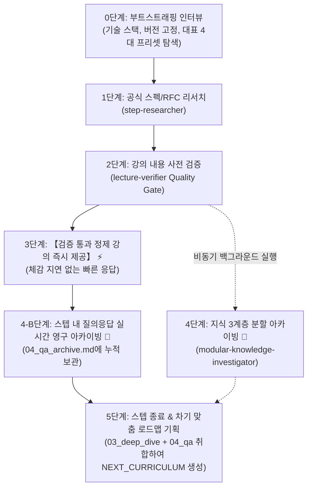

# 🌟 AI Study Engine (범용 AI 자기주도 학습 워크스페이스)

어떤 OS(Windows, macOS, Linux)에서든, 어떤 AI 에이전트(Antigravity, Claude Code, Cursor 등)를 사용하든 **터미널에서 한 줄 명령어로 나만의 검증형 AI 학습 워크스페이스를 즉시 스캐폴딩**하는 오픈소스 스타터 킷입니다.

---

## ⚡ 빠른 시작 (원클릭 스캐폴딩)

새로운 기술을 학습하고 싶은 디렉터리의 터미널에서 아래 명령어 한 줄을 실행하세요.

### 🪟 Windows (PowerShell)
```powershell
irm https://raw.githubusercontent.com/yg3988/learning-with-ai-tutor/main/install.ps1 | iex
```

### 🍏 macOS / 🐧 Linux (Bash/Zsh)
```bash
bash -c "$(curl -fsSL https://raw.githubusercontent.com/yg3988/learning-with-ai-tutor/main/install.sh)"
```

---

## 🤖 선택 가능한 AI 에이전트 및 생성되는 컨텍스트

설치 중 사용할 AI 에이전트를 선택하면, 불필요한 설정 파일 없이 **해당 에이전트에 100% 최적화된 마스터 지침 파일 단 1개만 루트에 깔끔하게 생성**됩니다:

| 번호 | 선택 에이전트 | 생성 파일 | 특화 최적화 |
| :--: | :-- | :-- | :-- |
| **1** | **Antigravity CLI** (권장) | `AGENTS.md` | `ask_question` 모달 UI 활성화, 백그라운드 비동기 서브에이전트 오케스트레이션 |
| **2** | **Claude Code** | `CLAUDE.md` | 단일 에이전트 자체 순차 수행(Self-Execution), 텍스트 번호 선택지 |
| **3** | **Cursor IDE** | `.cursorrules` | Cursor Chat/Composer 편집기 특화 마크다운 룰 |
| **4** | **모든 에이전트 호환** | All-in-One | 모든 에이전트가 동시에 인식할 수 있도록 브릿지 전체 생성 |

---

## 🏗️ 워크스페이스 아키텍처 및 파이프라인

스캐폴딩된 워크스페이스에서 에이전트를 열고 "**학습 시작하고 싶어**"라고 말하면 아래 5단계 고품질 파이프라인이 자동으로 작동합니다:



### 4대 지식 아카이빙 계층 (`knowledge/step_{N}_{slug}/`)
- `01_prerequisites_*.md`: 선행 네트워크/OS/문법 지식
- `02_foundations_*.md`: 해당 단계 핵심 표준 명세 및 실무 설정
- `03_deep_dive_*.md`: 대규모 분산 환경, 성능 최적화, 차기 프로젝트 후보
- `04_qa_archive.md`: 스텝 내 학습자의 모든 질의응답 및 심층 해설 실시간 영구 보관