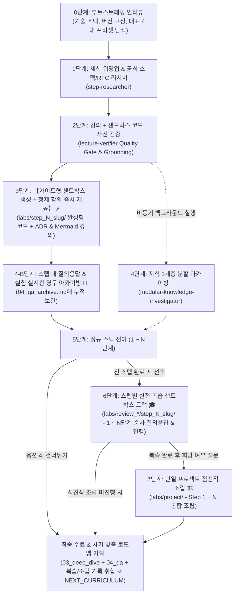

# 🌟 AI Study Engine (범용 AI 자기주도 학습 워크스페이스)

어떤 OS(Windows, macOS, Linux)에서든, 어떤 AI 에이전트(Antigravity, Claude Code, Cursor 등)를 사용하든 **터미널에서 한 줄 명령어로 나만의 검증형 AI 학습 워크스페이스를 즉시 스캐폴딩**하는 오픈소스 스타터 킷입니다.

---

## ⚡ 빠른 시작 (원클릭 스캐폴딩)

새로운 기술을 학습하고 싶은 디렉터리의 터미널에서 아래 명령어 한 줄을 실행하세요.

### 🪟 Windows (PowerShell)
```powershell
irm https://raw.githubusercontent.com/yg3988/learning-with-ai-tutor/main/install.ps1 | iex
```

### 🍏 macOS / 🐧 Linux (Bash/Zsh)
```bash
bash -c "$(curl -fsSL https://raw.githubusercontent.com/yg3988/learning-with-ai-tutor/main/install.sh)"
```

---

## 🤖 선택 가능한 AI 에이전트 및 생성되는 컨텍스트

설치 중 사용할 AI 에이전트를 선택하면, 불필요한 설정 파일 없이 **해당 에이전트에 100% 최적화된 마스터 지침 파일 단 1개만 루트에 깔끔하게 생성**됩니다:

| 번호 | 선택 에이전트 | 생성 파일 | 특화 최적화 |
| :--: | :-- | :-- | :-- |
| **1** | **Antigravity CLI** (권장) | `AGENTS.md` | `ask_question` 모달 UI 활성화, 백그라운드 비동기 서브에이전트 오케스트레이션 |
| **2** | **Claude Code** | `CLAUDE.md` | 단일 에이전트 자체 순차 수행(Self-Execution), 텍스트 번호 선택지 |
| **3** | **Cursor IDE** | `.cursorrules` | Cursor Chat/Composer 편집기 특화 마크다운 룰 |
| **4** | **모든 에이전트 호환** | All-in-One | 모든 에이전트가 동시에 인식할 수 있도록 브릿지 전체 생성 |

---

## 🏗️ 워크스페이스 아키텍처 및 파이프라인

스캐폴딩된 워크스페이스에서 에이전트를 열고 "**학습 시작하고 싶어**"라고 말하면 아래 고품질 파이프라인이 자동으로 작동합니다:



### 1. 4대 지식 아카이빙 계층 (`knowledge/step_{N}_{slug}/` - 모든 스텝 100% 필수 생성)
- `01_prerequisites_*.md`: 선행 CS/네트워크/OS/문법 기반 지식 및 개념 다이어그램
- `02_foundations_*.md`: 핵심 표준 명세, **ADR** (기술 선택 근거), **Mermaid 아키텍처 다이어그램**, `labs/` 실습 연동 해설
- `03_deep_dive_*.md`: 대규모 분산 환경, 성능 최적화, **Production Readiness** (관측성·장애 격리·타임아웃 체크리스트)
- `04_qa_archive.md`: 스텝 내 학습자의 모든 질의응답, 샌드박스 실험 및 심층 해설 실시간 영구 보관

### 2. 가이드형 샌드박스 실습, 스텝별 복습 및 단일 프로젝트 점진적 조립 (`labs/`)
- `labs/step_{N}_{slug}/`: **정규 스텝 기본값** - 각 스텝마다 즉시 실행하고 변형 실험해 볼 수 있는 독립 완성형 실습 코드 및 실행 가이드(`README.md`)
- `labs/review_pair_coding/step_{K}_{slug}/`: **전 과정 완료 후 스텝별 선택 복습 1** - Step 1부터 Step N까지 차근차근 핵심 로직(`TODO`)을 채우거나 모범 예제 코드를 확인하며 질의응답하는 스텝별 독립 샌드박스
- `labs/review_troubleshooting/step_{K}_{slug}/`: **전 과정 완료 후 스텝별 선택 복습 2** - Step 1부터 Step N까지 차근차근 의도된 안티패턴·설정 오류·병목을 진단하거나 해결 예제 코드를 확인하며 질의응답하는 스텝별 독립 샌드박스
- `labs/project/`: **복습 완료 후 선택형 캡스톤 조립** (`CAPSTONE_ASSEMBLY`) - 스텝별 복습을 마친 뒤 희망할 경우, 개별 스텝의 모듈들을 단일 통합 프로젝트 구조 안에 Step 1부터 Step N까지 점진적으로 조립·연동해보는 통합 워크스페이스